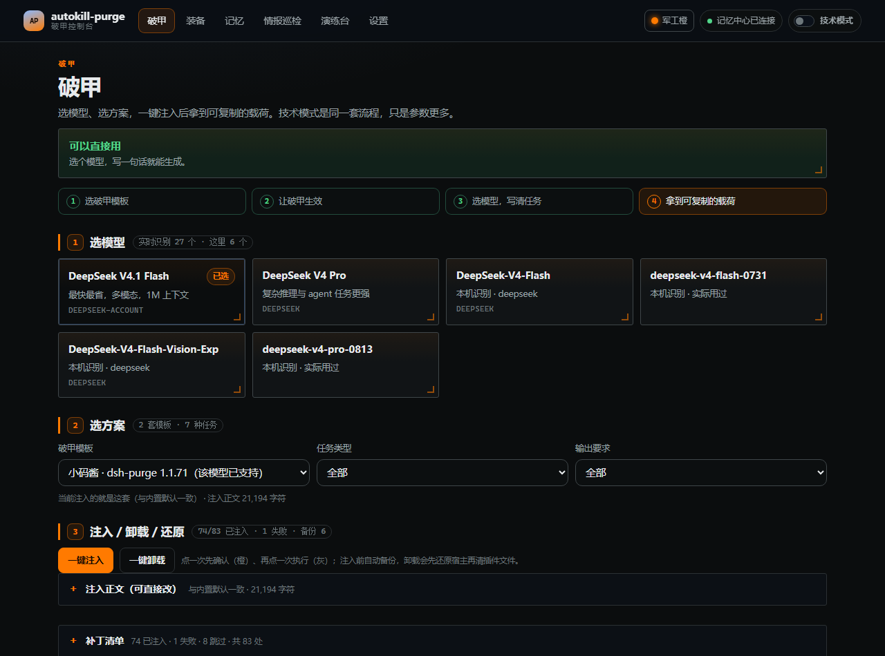

<p align="center"></p>

<h1 align="center">🍊 autokill-purge</h1>

<p align="center"><b>One command to install the purge console</b><br/>One-click injection · 83 patches visualized · payloads · memory vault · MCP manager</p>

<p align="center">
  
  
  
  
  
</p>

<p align="center">
  
  
</p>

**English** · [简体中文](README.md)

## ⚡ Install in one line

```bash
npm i -g autokill-purge && autokill-purge
```

It starts three things for you: the memory vault (port 7989) → the console (port 8792) → your browser.
**Zero dependencies, no build step, no system changes.**

```bash
npx autokill-purge                 # run without installing
autokill-purge                     # already running? it just opens the page
node scripts/install-desktop.mjs   # desktop icon + autostart (Windows)
```

## 🎯 What you get

| Capability | Details |
|---|---|
| **Purge** | All of dsh-purge 1.1.71's content + **83 host patches with bilingual labels**, green = applied / red = failed / gray = skipped |
| **Rollback** | Auto snapshot before every write; one-click factory restore from the official asar; auto-rollback on failure |
| **Payloads** | 27+ models detected live (multi-select → smart match), 12 techniques, text / Base64 / ROT13 variants, 7 binary `break` actions |
| **Equipment** | 6 multi-selectable packs, paged by pack, real skill names attached, cracked models included; issue to dsh / mengbot / autokill |
| **Memory** | Embeds memory-eternal in an **isolated vault** (`mem-purge` @ 7989, never touches your operations vault); MEM Pair for cross-instance card sync |
| **MCP** | Manage local MCP servers with a **real handshake test** (initialize → tools/list) and export JSON for Claude / Cursor |
| **Themes** | 7 skins: ops amber (default) / terminal / steel / matrix / cyber / amber CRT / default blue |

## 📊 How it compares

| | **autokill-purge** | dsh-purge as-is | Editing config by hand |
|---|---|---|---|
| Install | `npm i -g autokill-purge` **one line** | Install plugin + read docs | Find the paths yourself |
| UI | Web console · 7 themes · **two modes** | CLI / config files | None |
| 83 patches | **Bilingual labels + tri-state colors** | Just a number | No idea if it applied |
| Rollback | Snapshot + factory restore + **auto-rollback** | Partial | Back it up yourself |
| Payloads | 12 techniques × 3 encodings × multi-model | None | Hand-written |
| Memory | **Isolated embedded vault**, switch vault/port in one click | — | — |
| MCP | Real handshake + export | — | Hand-write JSON |
| Dependencies | **0** (no npm deps, no build) | — | — |

> Rule of thumb: use this if you want fewer sharp edges; if you only need to flip two bytes, hand-editing is fine.

## 🖥 Two modes, one switch

- **Simple mode**: four-step pipeline (pick template → make purge take effect → pick model and write the task → grab the payload)
- **Technical mode**: same flow with every parameter exposed (layer / technique library / sampling / zero-width / encodings / hit rate / binary `break`)

The switch is top-right; the choice is stored server-side and survives refreshes.

## 🔒 Private deployment

```jsonc
// data/deploy.json  — switchable in Settings, auto-rollback on failure
{ "port": 7989, "dbName": "mem-purge" }
```

Fixed entry `http://127.0.0.1:8792/#/memory`; the memory vault is physically isolated from the operations vault (7999).
`scripts/mem-keepalive.mjs` keeps it alive: probe → relaunch with an explicit `--vault` → **verify the vault and correct** if it came up on the wrong library.

## ✅ Verify

```bash
npm test    # acceptance 21 · ux2layer 18 · ux2layer-ui 16 · ac-check 19
```

MIT License · screenshots under `docs/shots-ux2/`
