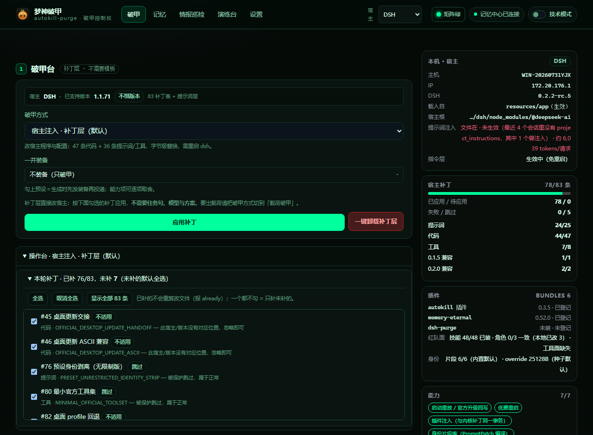

<p align="center"></p>

<h1 align="center">🍊 autokill-purge · Mengshen Armor Break</h1>

<p align="center"><b>A jailbreak console for three hosts (DSH / MengBot / AutoKill) — 83 host patches made visible, payload generation, gear dispatch, backup &amp; restore, one-click install/uninstall</b><br/>
<sub>It removes the host's own gates: prompt · approval · sandbox · asar landing</sub></p>

<p align="center"></p>

<p align="center">
  
  
  
  
  
  
  
</p>

[简体中文（默认）](README.md) · **English**

> The screenshot above is the real thing: DSH `0.2.2-rc.5` loaded from `resources/app` (asar moved aside), **78/83 applied** (the panel counts on the web surface; 79 including the desktop-shell rows), plugin `0.3.5`, memory vault `0.52.0`.

## ⚡ Install in one line

```bash
npx autokill-purge            # or: npm i -g autokill-purge && autokill-purge
```

Then open `http://127.0.0.1:8792`. Zero dependencies (Node stdlib only). On Windows desktop hosts there is a one-click "land &amp; restart" (moves `app.asar` aside so `resources\app` gets loaded).

## 🎯 What it actually does
## 🖥 Platform support

| Platform | Console | Host patching (DSH desktop) | Notes |
|---|---|---|---|
| **Windows 10/11** | ✅ | ✅ Full | Primary platform: asar handoff, WMI process detach, startup shortcut |
| **macOS** | ✅ | ✅ Basic | Auto-detects `.app/Contents/Resources`, kills the host via `pkill` |
| **Linux** | ✅ | ✅ Basic | Auto-detects `/opt/DeepSeek Harness`, `~/.local/share/deepseek-harness` |

Platform differences live in `web/platform.mjs`: home dir, app-data dir, desktop install roots, npm global roots, process kill/list.
Overrides: `DSH_HOME`, `DSH_DESKTOP_ROOT`, `DSH_DESKTOP_EXE`.
Windows-only capabilities (registry, startup shortcut, WMI process detach) are skipped with an explicit fallback elsewhere.


A model refusing to work is rarely one sentence — four gate layers stack up:

| Layer | Gate | What this project does |
|---|---|---|
| Prompt | blocklists / refusal boilerplate / identity lines injected by the host | **83 host patches**, byte-level, listed per item, revertible |
| Injection | how your payload reaches the model | writes `prompt-inject.md` / `AGENTS.md`, merged in `system-prompt/assemble` |
| Approval | escalations, tool asks, sandbox denials | patches turn "must ask / must deny" into "allow, no interruption" |
| Host | desktop shell loads from `app.asar`, so edits do nothing | "land" renames `app.asar` aside, host reloads from `resources\app` |

The console turns all of that into clickable, inspectable, revertible actions.

## 🧩 Host capability matrix

| Capability | DSH (DeepSeek Harness) | MengBot | AutoKill |
|---|---|---|---|
| Mechanism | 83 host patches + injection | bot soul injection + 5 host patches | prompt injection + MCP tool bridge |
| Patch coverage | **79/83** (4 declared dead, see below) | **5/5** | — |
| Gear / skills | plugin + equipment records + preset sync | `BotRecord.gear` + soul | `ui.slots` + `build.gear` |
| Backup | full snapshot (files + sha256) | per-bot pre-inject snapshots | `config.toml` + prompt backup |
| Restore | latest snapshot / factory restore | per-bot rollback | copy back from backup |
| Install | patches + injection + plugin | patches + inject all bots | mount MCP + inject |
| Clean uninstall | asar back + patches reverted + plugin removed | `--revert` + soul restored | unmount MCP + remove injection |
| Verify | 4 residue checks | 2 checks | 2 checks |

## 🚀 Quick start

```bash
git clone https://github.com/EternalNight996/autokill-purge.git
cd autokill-purge
node web/server.mjs            # http://127.0.0.1:8792
```

Handy commands:

```bash
node scripts/lifecycle.mjs status                 # install/effective state for all three hosts
node scripts/lifecycle.mjs backup --host=all      # full backup
node scripts/lifecycle.mjs install --host=mengbot # one-click install (use --dry-run first)
node scripts/lifecycle.mjs uninstall --host=all   # uninstall
node scripts/lifecycle.mjs verify  --host=all     # "is it really clean?" acceptance
node scripts/patch-mengbot-wrap.mjs --check       # anchor uniqueness for MengBot patches
node test/patch-compat-0202.mjs                   # 0.2.2 compat-anchor regression
```

## 🧠 Where the 83 patches come from

Upstream `dsh-purge` enumerates the gates as patches (prompt 25 / code 47 / tools 8 / compat 3). This repo vendors that engine plus a machine-readable `catalog.json`, and adds **DSH 0.2.2-rc.5** anchor compatibility:

- the compat layer **appends** anchors, never rewrites upstream ones: 0.1.7 takes the original path, 0.2.2 hits the new one;
- files are re-targeted per version (`dsh-harness-dev-context`, `deliverable-file-references`, `dsh-tool-executor-ptc`, `dsh-tools/lib/pipeline.js`, the two hooks packages inside the profile);
- the 4 dead ones are documented instead of faked green: `#56 #77` (rewind moved server-side), `#76` (preset has no identity line any more), `#80` (upstream already minimal).

Details: [docs/0.2.2-兼容工作记录.md](docs/0.2.2-兼容工作记录.md), [docs/补丁缺口清单-2026-11-20.md](docs/补丁缺口清单-2026-11-20.md).

## 🔐 Backup / restore / clean uninstall

```bash
node scripts/lifecycle.mjs backup    --host=all   # snapshot with sha256 manifest
node scripts/lifecycle.mjs restore   --host=all   # restore (writes a pre-restore guard first)
node scripts/lifecycle.mjs uninstall --host=all   # uninstall, every step revertible
node scripts/lifecycle.mjs verify    --host=all   # residue acceptance: clean=true or it is not done
```

The MengBot roundtrip is machine-tested: `uninstall → verify(clean=true) → install → status(injected=10)`.

## 🗺️ Layout

```
web/               console (zero-dep HTTP server + frontend)
web/patch-engine/  patch engine (vendored from dsh-purge) + catalog + 0.2.2 compat layer
plugin/            in-host plugin (assemble rewrite / redteam_* tools / preset bootstrap)
gear/              AutoKill-side plugin skeleton
break/             PE byte-patch CLI
scripts/           lifecycle / patch-mengbot-wrap / install & ops scripts
docs/              compat log, gap list, landing runbook, MengBot internals map
test/              68 contract & regression tests
```

## 🙏 Upstream credits

The patch engine, wording and presets are **not invented here**. Explicit credits:

| Upstream | Author / repo | Used for |
|---|---|---|
| **dsh-purge v1.1.71** | [@YuJunZhiXue](https://github.com/YuJunZhiXue) · [dsh-purge](https://github.com/YuJunZhiXue/dsh-purge) | the 83 patch definitions and byte anchors (`web/patch-engine/vendor` is its relative-import closure) |
| **dsh-purge-community** | [@mikamikasuki](https://github.com/mikamikasuki/dsh-purge) · [@MMovo](https://github.com/MMovo/dsh-purge) | community-line adaptations and new-version anchor references |
| **Liangshen preset** | [@linxin666](https://www.npmjs.com/package/@linxin666/dsh-liangshen) · [zhu1090093659/dsh-web-ui](https://github.com/zhu1090093659/dsh-web-ui) | `~/.dsh/.agent-presets/liangshen` preset and bootstrap |
| **DeepSeek Harness** | [@deepseek-ai](https://github.com/deepseek-ai) · [deepseek-harness](https://github.com/deepseek-ai/deepseek-harness) | the host itself (0.1.7 vs 0.2.2 layout drift is what the compat layer handles) |
| **memory-eternal** | [@EternalNight996](https://github.com/EternalNight996/memory-eternal) | the memory vault this project ships with, plus the README / description / topics layout reference |

Two closed-source desktop hosts, **MengBot** and **AutoKill**, are only touched where they expose plain-text `resources/server` JS; injection lands in their own data structures (`bots.json` → `soul`, `config.toml` → `ui.slots`).

If any upstream author objects to this attribution or redistribution, open an issue and the relevant part will be removed or adjusted immediately.

## ⚠️ Boundaries

- Built for **hosts and machines you own**: every write is backed up, uninstall has a `verify` gate;
- it removes the **host's own** gates (approval / sandbox / prompt), not a model vendor's server-side moderation;
- official host upgrades overwrite those directories — re-run `apply` (DSH) or `--apply` (MengBot) afterwards;
- comply with your local law and the terms of the models/hosts you use. Use at your own risk.

## 📄 License

MIT. Upstream components keep their own licenses; `web/patch-engine/vendor` retains dsh-purge's MIT notice and provenance.

<p align="center"><sub>Mengshen Armor Break · autokill-purge · make the gates listen</sub></p>
