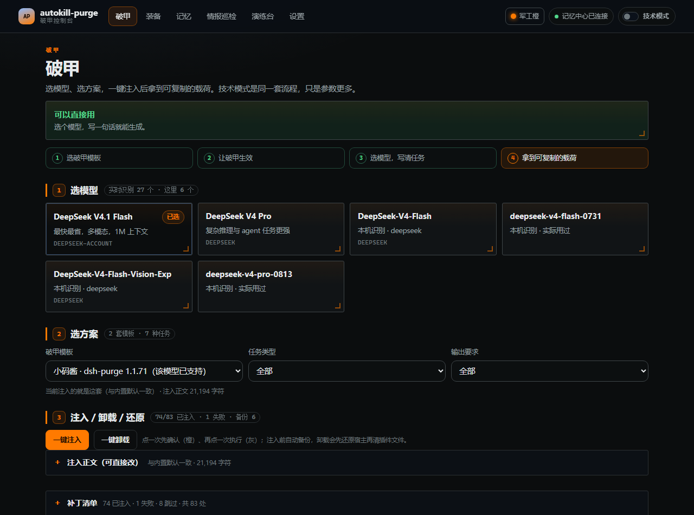

<p align="center">
  
</p>

<h1 align="center">autokill-purge</h1>

<p align="center">
  <b>破甲控制台</b> — 一键注入 · 装备发放 · 记忆库 · MCP · 14k POC 知识库<br />
  <sub>零依赖 Node 控制台 / 两套界面一键切换 / 私有部署隔离库</sub>
</p>

<p align="center">
  
  
  
  
  
</p>

<p align="center">
  
  
</p>

<p align="center"><sub>左：破甲页 —— 选模型 → 选方案 → 一键注入 → 补丁清单 → 生成载荷　|　右：记忆库 —— 内嵌 memory-eternal，独立库 mem-purge</sub></p>

<p align="center">
  <a href="#中文">中文</a> · <a href="#english">English</a>
</p>

---

## 中文

### 这是什么

`autokill-purge` 是一个**本机控制台**，把三件事放在一个界面里：

| 能力 | 说明 |
| --- | --- |
| **破甲** | 把 dsh-purge 1.1.71 的那套内容与 83 条宿主补丁，做成可点、可看、可回滚的界面（注入正文 21,194 字符、补丁清单中英对照、绿/红/灰状态） |
| **载荷生成** | 选模型（实时识别 27+ 个）→ 选层/技术/角色/输出 → 一键生成可复制的载荷（文本 + Base64 + ROT13 变体），支持二进制 `break` 七动作 |
| **装备发放** | 6 个装备包 × 能力项 × 已破甲模型，装给 dsh / mengbot / autokill，产出可复制的 JSON 配置，留下发放历史 |
| **记忆库** | 内嵌 memory-eternal（**独立库 mem-purge @ 7989**，与运营库完全隔离），全屏铺满，MEM Pair 配对互相传卡 |
| **MCP** | 管理本机 MCP 服务器，**真握手测试**（initialize → tools/list），导出 Claude Desktop / Cursor 可用的 JSON |
| **主题** | 7 套皮肤：军工橙（默认）/ 终端黑 / 工程灰 / 矩阵绿 / 赛博青 / 琥珀 CRT / 默认蓝 |

**零依赖**：没有 npm 依赖、没有构建步骤，`node web/server.mjs` 直接跑。

### 快速开始

```powershell
git clone <repo-url> autokill-purge
cd autokill-purge
node web/server.mjs            # 打开 http://127.0.0.1:8792
```

装桌面图标 + 开机自启（Windows）：

```powershell
node scripts/install-desktop.mjs             # 桌面快捷方式 + 启动项
node scripts/install-desktop.mjs --status    # 看装没装
node scripts/install-desktop.mjs --uninstall # 只删快捷方式
```

双击图标 = 起**记忆库（mem-purge @ 7989）** + **控制台（8792）** + 打开浏览器，已在跑就跳过。

### 两套界面，一键切换

- **普通模式**：引导式流水线，四步走完（选模板 → 让破甲生效 → 选模型写任务 → 拿到载荷）
- **技术模式**：同一套流程但参数全开（层 / 技术库 / 采样 / 零宽 / 编码变体 / 命中率 / 二进制 break）

右上角一个开关来回切，读的是服务端设置，刷新保持。

### 私有部署（库名 + 端口）

```jsonc
// data/deploy.json
{ "port": 7989, "dbName": "mem-purge", "entryHash": "#/memory" }
```

- 入口固定 `http://127.0.0.1:8792/#/memory`（打开根地址自动落这里）
- 记忆库与运营库（7999 / `~/.dsh/memory-vault`）**完全隔离**
- 设置页「私有部署」可**一键切换端口与库名**：停旧实例 → 可选迁移 db → 起新实例 → 核对 vault → 成功才落盘，失败自动回滚

```powershell
Invoke-RestMethod -Uri http://127.0.0.1:8792/api/deploy/switch -Method POST `
  -ContentType application/json `
  -Body '{"confirm":true,"port":7991,"dbName":"mem-purge-x","migrate":true}'
```

### 保活

`scripts/mem-keepalive.mjs` 每 10s 探一次 `/health`，不通就用显式 `--vault` 拉起；**拉起后核对 vault**，发现跑在别的库上会强制纠正。

```powershell
node scripts/mem-keepalive.mjs --interval 10000   # 常驻
node scripts/mem-keepalive.mjs --once             # 单次自检
```

> 为什么不用它自带的 watchdog：memory-eternal 的 watchdog 拉起 web 时「vault-pref 的 activeVault 优先于 `--vault`」，
> 而本机 activeVault 指向运营库 —— 用它托管会静默起在运营库上（实测 quarantined 会从 39 变 232）。

### 用 CLI 管隔离库

```powershell
$cli = "$env:USERPROFILE\.dsh\profiles\desktop\node_modules\memory-eternal\bin\dsh-memory.mjs"
$env:MEMORY_VAULT_DIR = "$env:USERPROFILE\.dsh\memory-vault-mem-purge"

node $cli status --port 7989 --json          # watchdog / 版本 / 存活
node $cli audit list --status pending --json # 待审卡片
node $cli ledger --days 7 --json             # 召回与蒸馏账本
```

设置页「记忆库 CLI」把这些按钮化了（看待审 / 看账本 / 重启 / 停止）。

### MEM Pair（和另一个实例互相传卡）

```powershell
node $cli peer code                        # 本机匹配码（形如 SGT9-2P42）
node $cli peer discover                    # 局域网找同类（UDP 7990）
node $cli peer pair 192.168.1.20:7989      # 首次配对（对方确认）
node $cli peer connect SGT9-2P42           # 凭码重连
node $cli peer upload --to XXXX-XXXX       # 推卡给对方（对方进待审）
```

设置页「MEM Pair」是同功能界面。

### 验收（四套，全零依赖）

```powershell
node test/acceptance.mjs      # 21 项：接口 / 协议门 / 载荷 / 装备 / 记忆
node test/ux2layer.mjs        # 18 项：两层界面契约
node test/ux2layer-ui.mjs     # 16 项：真实浏览器（CDP）交互
node _ui-test/ac-check.mjs    # 19 项：端到端功能
```

### 目录

```
web/            server.mjs（单文件 HTTP）· app.js（前端）· style.css（7 套主题）
                host.mjs（宿主破甲）· kb.mjs（POC 库）· peer.mjs / memcli.mjs / deploy.mjs
scripts/        launch.mjs（启动器）· install-desktop.mjs · mem-keepalive.mjs
                seed-redteam-memory.mjs · make-icon.py / make-icon-variants.py
test/ · _ui-test/   四套验收
docs/shots-ux2/     截图证据（40 张）
assets/             图标（.ico / .png）+ 四款备选
```

---

## English

### What it is

`autokill-purge` is a **local control console** for three things in one place:

| Capability | What it does |
| --- | --- |
| **Purge** | Wraps dsh-purge 1.1.71's content (21,194-char injection body) and 83 host patches into a clickable, inspectable, rollback-safe UI |
| **Payloads** | Pick a model (27+ detected live) → layer / technique / role / output → one-click payload (text + Base64 + ROT13), plus 7 binary `break` actions |
| **Equipment** | 6 packs × capability items × cracked models, issued to dsh / mengbot / autokill, producing a copyable JSON config with history |
| **Memory** | Embeds memory-eternal (**isolated vault `mem-purge` @ 7989**), full-bleed, with MEM Pair for cross-instance card sync |
| **MCP** | Manage local MCP servers with a **real handshake test** (initialize → tools/list) and export JSON for Claude Desktop / Cursor |
| **Themes** | 7 skins: ops amber (default) / terminal / steel / matrix / cyber / amber CRT / default blue |

**Zero dependencies**: no npm install, no build step — just `node web/server.mjs`.

### Quick start

```powershell
git clone <repo-url> autokill-purge
cd autokill-purge
node web/server.mjs            # http://127.0.0.1:8792
```

Desktop icon + autostart (Windows):

```powershell
node scripts/install-desktop.mjs             # shortcut + startup entry
node scripts/install-desktop.mjs --status
node scripts/install-desktop.mjs --uninstall
```

### Private deployment

```jsonc
// data/deploy.json
{ "port": 7989, "dbName": "mem-purge", "entryHash": "#/memory" }
```

Fixed entry `http://127.0.0.1:8792/#/memory`; the memory vault is fully isolated from the operations vault
(7999 / `~/.dsh/memory-vault`). The settings page can **switch port and vault name in one click**
(stop old → optional db migration → start new → verify vault → persist, auto-rollback on failure).

### Keep-alive

`scripts/mem-keepalive.mjs` probes `/health` every 10s and relaunches with an explicit `--vault`,
then **verifies the vault** and corrects it if the process came up against the wrong library.

> The bundled memory-eternal watchdog prefers `vault-pref`'s `activeVault` over `--vault`, so it silently
> starts on the operations vault (quarantined went 39 → 232 in our test). That is why this repo ships its own.

### Verify

```powershell
node test/acceptance.mjs      # 21 checks: API / agreement gate / payload / equipment / memory
node test/ux2layer.mjs        # 18 checks: two-layer UI contract
node test/ux2layer-ui.mjs     # 16 checks: real browser (CDP)
node _ui-test/ac-check.mjs    # 19 checks: end-to-end
```

### License

MIT. 图标与截图为本仓库自制；`dsh-purge` 内容按其原许可证（MIT）署名使用。

## 发布状态

| 目标 | 状态 | 地址 |
| --- | --- | --- |
| **GitHub** | ✅ 已发布（140 文件 / 41 张截图 / README 顶部图标 + 两张截图正常渲染） | https://github.com/EternalNight996/autokill-purge |
| **npm** | ✅ 已发布 `autokill-purge@1.1.1`（latest；含 1.1.0 与 `0.0.0-stage` 占位） | https://www.npmjs.com/package/autokill-purge |
| **Gitee** | ✅ 已发布（140 文件 / 41 张截图，与 GitHub 同源） | https://gitee.com/eternalnight996/autokill-purge |

### npm 说明

首次发版会经过 npm 的 staged publishing，期间 registry 里先出现 `0.0.0-stage` 占位，
待审版本（`1.1.0`）随后转正。当前已正式上架：

```bash
npm i autokill-purge          # 装成依赖
npx autokill-purge            # 直接跑启动器（起记忆库 + 控制台 + 开浏览器）
```

> 小提示：同一版本号二次 publish 会报 `E409 Cannot publish over previously staged version` ——
> 改 `package.json` 的 version 再发即可（本次就是先发 1.1.0、被 stage 占位后没有重复发）。

### 一键发布脚本

```powershell
# 凭据从 0600 文件读入环境变量（不回显、不进聊天）
$envMap = @{}
Get-Content C:\Users\Administrator\.dsh\creds.env | Where-Object { $_ -match '=' -and -not $_.StartsWith('#') } |
  ForEach-Object { $i = $_.IndexOf('='); $envMap[$_.Substring(0,$i).Trim()] = $_.Substring($i+1).Trim().Trim('"') }
$env:GITHUB_TOKEN = $envMap['GITHUB_TOKEN']; $env:GITHUB_REPO = 'EternalNight996/autokill-purge'
$env:NPM_TOKEN    = $envMap['NPM_TOKEN'];    $env:NPM_NAME    = 'autokill-purge'

node scripts/publish.mjs              # 全发（缺哪个凭据就跳过哪个）
node scripts/publish.mjs --github     # 只推仓库
node scripts/publish.mjs --npm        # 只发 npm
node scripts/publish.mjs --dry-run    # 只看步骤
```

脚本做的事：发布前用 API 检查/创建仓库 → 用带 token 的 remote `git push -u`（推完立刻 set-url 去掉 token）
→ 临时 `.npmrc`（gitignore 已排除）发 npm → 发完即删。
